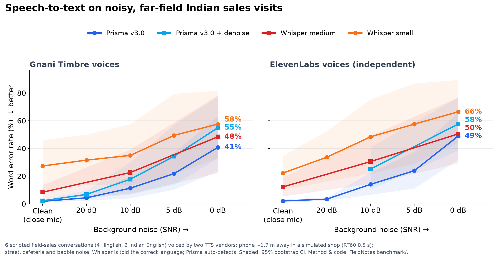

<div align="center">

# Nabz · नब्ज़

**The pulse of every field conversation.**

*"Bazaar ki nabz pakadna"*: to have your finger on the market's pulse.

Nabz turns the conversations FMCG field reps have at the kirana counter into **market intelligence**
for sales and brand leaders (competitor credit, scheme confusion, slow movers, stock-outs), and into
**coaching** for the reps who had them. Speech in and out is **Gnani AI** (Prisma v3.0 and Timbre v3.0).
Every insight carries a quote verified against the transcript in code.


**[One-page pitch](PITCH.md)** · [Business case](docs/BUSINESS_CASE.md) · [Noise benchmark](benchmark/)

</div>

---

## The problem

**89% of India's offline FMCG sales go through traditional trade** (NIQ, Q1 2026). That share is
decided in face-to-face conversations at the counter, in Hinglish and other Indian languages, over
street noise. When a kirana owner says *"Britannia wala pandrah din ka credit de raha hai"*, it
reaches head office weeks later, through a retail audit, a lost-share report, or not at all.
Meanwhile quick commerce is taking share from general trade every quarter.

Nabz captures those conversations, with the customer's consent, and turns them into quoted,
region-by-region intelligence the same day. The rep gets coaching on the visit in their own language.

**Who it's for (beachhead):** Indian FMCG, food and beverage brands with ₹500–5,000 Cr turnover,
200–2,000 field reps and distributor salesmen, and over 70% of sales through general trade. The full
case, with sources, pricing, unit economics and an honest risk section, is in
[`docs/BUSINESS_CASE.md`](docs/BUSINESS_CASE.md).

## What it does

| For | They get |
|---|---|
| **Sales and brand leaders** | A market-intelligence dashboard: competitor share of voice by region, demand per product, price sensitivity by outlet type, scheme feedback, and a voice-of-customer feed where every card is a verbatim quote |
| **Area managers** | Visit scorecards through the right lens, team coaching (talk ratio, questions asked), compliance flags, and CRM updates they approve |
| **Field reps** | A mobile web app with nothing to install: a consent step, then one tap to record or upload. A **20–30 s voice debrief in their language, voiced by Gnani Timbre** |

## How a visit flows

```text
consent ─► Gnani Prisma v3.0 (batch) ─► PII redaction ─► Claude analysis ─► quote check (code) ─► Gnani Timbre debrief
 (verbal: verified   diarization · indic-auto     in-process, before   Haiku 5.5 first;    exact words, one        in the rep's
  on tape)           codemix · keyterms             any file is written  Opus 5.5 if needed  speaker, same numbers   language
                                                                                             and negations
                 manager approves the CRM update and follow-up  ◄─┘     dashboard updates with quoted signals by region × segment
```

## Gnani AI inside

| Gnani model | Used for |
|---|---|
| **Prisma v3.0** (Batch STT) | **Diarization** (speaker labels matched the script on 59/60 segments in our test) · `indic-auto` language detection · **`codemix`** keeps "Parle-G", "carton" and "scheme" in Latin script inside Devanagari · **`keyterms`** from the workspace's products, competitors and account names (never people's names) · `with_denoise` tested and **turned off**: in our benchmark it raised word error from 12.7% to 21.4% at 10 dB SNR · browser recordings and phone voice notes uploaded directly |
| **Timbre v3.0** (TTS) | The rep's voice debrief (Hinglish, Hindi or English in the demo; Timbre supports 10 Indian languages) · the synthetic demo visits · test speech for the noise benchmark |

**The reasoning layer is Claude, not Gnani's Evon.** Evon v3.3 has open weights on request but no
hosted API (see [`docs/research/GNANI_API_NOTES.md`](docs/research/GNANI_API_NOTES.md)), and Gnani's
own call-analytics guide pairs Prisma with Claude or GPT-4o. The model sits behind one function
(`tools/llm.py`). The sovereign path is Prisma on-premises plus self-hosted Evon.

## Cost per visit (measured)

| | Measured |
|---|---|
| Claude Haiku 5.5 (every visit) | **₹0.32** for a 1-minute synthetic visit; 15/15 quotes verified on the first pass |
| Claude Opus 5.5 (only when escalated) | ~₹10 per visit. Escalation happens only for a recorded reason: compliance flag, failed quotes, low confidence, suspected manipulation, or a long visit |
| Gnani Prisma | ~₹27 per audio hour (reseller list price; direct pricing not public) |

Real 5–8 minute visits will cost more than the demo's 1-minute visits. Re-measuring on real audio is
the first pilot task.

## Why trust it (each line is checked by the tests in `tests/`)

| Control | What the code does |
|---|---|
| **Consent before processing** | Uploads are refused without consent. For *verbal* consent, the transcript must show a consent request and a "yes" from another speaker within 90 s; otherwise the visit stops at `needs_consent_review` (no AI analysis) until a manager reviews it |
| **Identifiers redacted before any AI or file** | Aadhaar (Verhoeff checksum), PAN, GSTIN, phone, card (Luhn), account number, IFSC, UPI and email, including numbers spoken in English or Hindi words and numbers split across two segments. **Names of people and businesses are not redacted**, because the analysis needs them |
| **No invented evidence** | Every judgement quotes the transcript. Quotes must match exactly, from one speaker, with the same numbers and negations ("will switch" never verifies "will **not** switch"). One retry, then unverified claims are dropped and counted. Visits with invalid output, or where most quotes fail, are rejected, not shown |
| **Untrusted text stays data** | The transcript and rep note are delimited and escaped. Manipulation phrasing escalates the visit and is recorded |
| **Humans approve the system of record** | CRM updates and follow-ups are proposals. Numbers in them that weren't said in the conversation are shown as warnings. Reps can't approve their own flagged or low-scoring visits |
| **Tamper-evident audit log** | An HMAC-keyed hash chain with a signed anchor (edits and truncation are detected). Customer names are stored as keyed hashes |
| **Retention and erasure** | Raw audio is deleted after 1 day (a job runs at startup and every 6 hours). Erasure removes the visit, its CRM entries and usage rows, cancels in-flight processing, and keeps a tombstone. Only admins can erase a visit with a compliance flag |
| **Access** | Signed, expiring sessions with a PIN per user (demo mode). CSRF header, CSP and an integrity-pinned Chart.js. Roles: rep (own visits), manager (team and intelligence), admin (audit and erasure) |
| **Where data goes** | Speech: Gnani batch results are served from AWS `ap-south-1` (Mumbai). **Analysis: the Anthropic API, outside India**, on redacted text |

**Not yet:** SSO/OIDC (the PIN login is demo-grade), SOC 2 or ISO 27001, offline capture, WhatsApp,
and a real-audio benchmark. A strict independent audit and its remediation are in
[`docs/AUDIT.md`](docs/AUDIT.md).

## Noise benchmark

Prisma is trained on phone audio. Field recordings come from one phone about 1.7 m away in a shop.
So we tested Prisma and Whisper in a simulated shop (RT60 0.5 s) with street, cafeteria and babble
noise at 20/10/5/0 dB SNR. Six scripted field-sales conversations (4 Hinglish, 2 Indian English) were
each voiced **twice, by two independent vendors** (Gnani Timbre and ElevenLabs), so this isn't only
Gnani TTS scored by Gnani ASR.

| Word error rate (Timbre / ElevenLabs voices) | Clean | 10 dB | 0 dB |
|---|---|---|---|
| **Gnani Prisma v3.0** | **1.8% / 2.1%** | **11.3% / 14.1%** | 40.7% / 48.9% |
| Whisper medium | 8.4% / 12.2% | 22.6% / 30.5% | 48.4% / 50.5% |
| Whisper small | 27.3% / 22.2% | 35.0% / 48.4% | 57.6% / 66.4% |



What we learned, including what doesn't flatter Prisma:
- **Hinglish and code-mix are where Prisma wins**, on both voice vendors. Keyterm recall (brands,
  prices, days) pooled across both: Prisma 94% / 89% / 59% at clean / 10 dB / 0 dB, Whisper medium
  71% / 60% / 42%.
- **On Indian English, Whisper matches or beats Prisma** (at 0 dB: Whisper medium 12–21% WER,
  Prisma 28–48%).
- **Prisma's `with_denoise` made things worse every time** (10 dB: 12.7% → 21.4% WER), so Nabz
  turns it off. **`keyterms` made no measurable difference** ("Delhivery" still came out as "delivery").
- **Speaker attribution held up:** 99–100% down to 10 dB, 87–94% at 0 dB.
- **At 0 dB every system loses about half the words.** Nabz tells reps to put the phone between the
  two speakers.
- Caveats: synthetic voices are cleaner than real people; n = 6 conversations per source. Real
  recordings come next. Method, code and every table are in [`benchmark/`](benchmark/).

## Run it

**You need:** Python 3.10+, ffmpeg, a Gnani API key (`GNANI_API_KEY` in `.env`), and `ANTHROPIC_API_KEY`.

```bash
git clone https://github.com/Dupahar/Nabz.git && cd Nabz
python -m venv .venv && .venv/Scripts/pip install -r requirements.txt   # macOS/Linux: .venv/bin/pip
cp .env.example .env              # add GNANI_API_KEY=...
.venv/Scripts/python -m uvicorn app.server:app --port 8000
.venv/Scripts/python -m pytest -q # 50 tests, no paid API calls
```

Open <http://localhost:8000> and pick a user. Arjun, Sneha and Ravi are reps who record (demo PIN
**`1234`**). Kavita (manager) sees the dashboard and Meera is admin. Their PINs are private in this
repo's config, so set your own first:

```bash
./py tools/set_pin.py --handle kavita --pin 1234
./py tools/set_pin.py --handle meera --pin 1234
```

Recording from a phone browser needs HTTPS (a tunnel or deployment); uploading a file works anywhere.

```bash
./py tools/pipeline.py demo/kirana_snippet.ogg --rep arjun --account "Sharma Kirana" --segment Kirana --consent rep-confirmed
./py tools/intel.py --days 30
```

**Configure** the company, team (roles, languages, regions), outlet types, product and competitor
vocabulary, privacy and LLM routing in [`config/workspace.yaml`](config/workspace.yaml). Add a
conversation type as a YAML file in [`lenses/`](lenses/).

**Chat channel (optional):** the same tools drive three Claude Code agents in a Telegram group via
[Switch](https://github.com/sandbox-quantum/switch) (`switch/nabz.template.yaml`, `playbooks/`).
Carried over from FieldNotes; not re-tested end to end under the Nabz name.

## Project structure

```text
app/server.py            FastAPI: API (docs/API.md), sessions, roles, CSRF/CSP, uploads, retention scheduler
app/static/              mobile recorder, visit page, market-intelligence dashboard
config/workspace.yaml    company, team, segments, vocabulary, privacy, LLM routing, rates
lenses/*.yaml            fmcg-retail · sales · pharma-detailing · collections · support · general
tools/
  pipeline.py            consent → transcribe+redact → analyse → metrics → debrief (resumable)
  gnani.py               Prisma batch STT + Timbre TTS client
  llm.py                 Haiku→Opus routing, delimited prompts, quote retry, rejection, number warnings
  analysis.py            lenses, schema, exact quote verification, scorecard
  redact.py · consent.py · audit.py · retention.py · intel.py · cost.py · metrics.py · voice.py · crm.py
tests/                   50 tests: auth, CSRF, uploads, consent, erasure, audit, retention, grounding, redaction, LLM post-processing
benchmark/               Prisma vs Whisper noise benchmark
demo/                    seed visits (Timbre voices), ElevenLabs visit generator, a script to record
docs/                    business case, audit, API contract, research, submission
```
