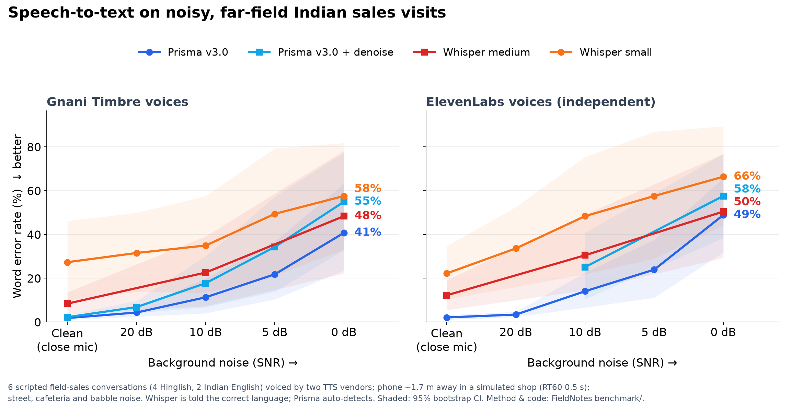

# Noise benchmark: Prisma v3.0 vs Whisper on far-field, noisy Indian sales visits

Nabz transcribes **in-person** conversations: a phone on a shop counter, recording a rep and a customer
over street traffic or a crowded shop. Gnani markets Prisma for telephony audio, and we found no public
numbers for this kind of far-field recording. So we measured it ourselves, with a reproducible method.

**Results: [results/summary.md](results/summary.md).** Charts: [results/wer_vs_snr.png](results/wer_vs_snr.png),
[results/keyterm_recall.png](results/keyterm_recall.png).



## Findings
Phonetic WER, pooled over both speech sources (12 recordings per condition, 95% CI in [results/summary.md](results/summary.md)):

| | Clean | 10 dB | 0 dB |
|---|---|---|---|
| Prisma v3.0 | **2.0%** | **12.7%** | **44.8%** |
| Whisper medium (told the language) | 10.3% | 26.5% | 49.4% |
| Whisper small (told the language) | 24.8% | 41.7% | 62.0% |
| Prisma keyterm recall (brands, prices, dates) | 94% | 89% | 59% |
| Whisper medium keyterm recall | 71% | 60% | 42% |

1. **Hinglish is where Prisma wins, and the win holds on both voice vendors.** On clean Hinglish, Prisma's WER is 1.2% (Timbre voices) and 2.0% (ElevenLabs voices), against 12–18% for Whisper medium and 34–41% for Whisper small. At 10 dB: Prisma 14–17%, Whisper medium 34–45%. Results on the independent ElevenLabs voices are within the confidence interval of the Timbre results, so the lead is not an artefact of Gnani-on-Gnani testing.
2. **On Indian English, Whisper is as good or better.** Whisper medium gets 1.5–3% at 10 dB versus Prisma's 5.6–9%, and 12–21% at 0 dB versus Prisma's 28–48%. Prisma's advantage is Indian languages and code-mixing, not English.
3. **Every system falls apart at 0 dB** (noise as loud as the speech): 45–62% WER, with keyterm recall around 60% at best. A phone held close beats any model, so Nabz tells reps to put the phone between the two speakers.
4. **`with_denoise` made Prisma worse in every noisy condition** we tested: 21.4% vs 12.7% at 10 dB, and 56% vs 45% at 0 dB. We leave it off.
5. **`keyterms` (a 35-term catalogue) made no measurable difference** (2.0% vs 2.0% clean, 45.1% vs 44.8% at 0 dB). Some brand names are missed even on clean audio with keyterms on: *Delhivery* is written as "delivery", and *Zenova* is mangled.
6. **Prisma's diarization holds up:** 99–100% of speech goes to the right speaker down to 10 dB, and 87–94% at 0 dB. That is good enough for talk-ratio coaching above about 5 dB.
7. Keyterm matching is strict and was fixed before we looked at any output. A few misses are arguably just spelling, for example RERA written as "रीरा". We didn't loosen the lists afterwards, because that would tune the test toward whichever system we were inspecting.

## Method

| Step | What we did |
|---|---|
| Conversations | 6 role-play sales visits ([scripts/](scripts/)), about 50 s each: 4 in Hinglish (kirana distributor, medical rep, loan field officer, real-estate site visit) and 2 in Indian English (industrial pumps, D2C logistics). Each contains business-critical entities such as brands, competitors, prices in lakh/rupees and days. |
| Speech | Every conversation is rendered **twice, by two independent TTS vendors**: Gnani **Timbre v3.0** (two voices per conversation, set in the script's `# voices:` line) and **ElevenLabs** `eleven_multilingual_v2` with shared-library Indian voices (Raju, Bunty, Sia, Simran, Kashvi; the per-script mapping is `EL_VOICES` in [run.py](run.py)). Lines are joined with the same 0.3–0.5 s gaps for both sources. Reference text is the script itself. Hinglish is written the way Prisma's `codemix` format writes it, with Hindi in Devanagari and English words in Latin, and both vendors were given exactly that text. |
| Room | [pyroomacoustics](https://github.com/LCAV/pyroomacoustics) image-source model of a 7×5×3 m shop with RT60 0.5 s. Each speaker is convolved with their own room impulse response; the phone lies on the counter about 1.6–1.9 m from them. |
| Noise | [DEMAND](https://zenodo.org/records/1227121) street traffic (STRAFFIC) and cafeteria (PCAFETER), channel 1, plus a 6-voice babble bed made from overlapping Timbre speech. Two conversations per noise type. Mixed at 20, 10, 5 and 0 dB SNR against active-speech power (20 ms frames within 40 dB of the loudest), with a fixed seed. |
| Conditions | `clean` is the dry, close-mic audio. `ff20` to `ff0` add the room and noise. |
| Systems | **Prisma v3.0** batch (`indic-auto`, `codemix`, diarization, 2 speakers) in up to four variants: plain; `with_denoise`; `keyterms` (the 35 brand, product and competitor names from all scripts, like a company catalogue); and denoise + keyterms. **faster-whisper** `small` and `medium` (int8, CPU, VAD, beam 5) are given the *correct* language as a hint (`hi` or `en`), a stronger baseline than auto-detect. Prisma gets no language hint. To stay within the credit and CPU budget, not every system ran every condition; see the coverage table below. |
| Metrics | WER and CER (jiwer) after [normalize.py](normalize.py); **keyterm recall**, the share of the business entities in [scripts/*.keyterms.json](scripts/) that appear in the transcript in any accepted spelling; and **speaker attribution** for Prisma, the share of speech duration assigned to the right person, using the best one-to-one mapping of diarization labels to speakers. 95% CIs are a bootstrap over conversations (2,000 resamples, corpus-level WER). |

### Coverage (which system ran on which conditions)
| System | Timbre voices | ElevenLabs voices |
|---|---|---|
| Prisma v3.0 | all 5 conditions | all 5 conditions |
| Prisma v3.0 + denoise | all 5 | 10 dB, 0 dB |
| Prisma v3.0 + keyterms | clean, 10 dB, 0 dB | clean, 10 dB, 0 dB |
| Prisma v3.0 + denoise + keyterms | clean, 10 dB, 0 dB | not run |
| Whisper small | all 5 | all 5 |
| Whisper medium | clean, 10 dB, 0 dB | clean, 10 dB, 0 dB |

A results cell is reported only when the system covered every conversation in it. "Pooled" rows need both speech sources.

### Normalisation (applied identically to every reference and hypothesis)
1. Devanagari is transliterated to Latin (ITRANS via `indic-transliteration`). Long and short vowels are merged, the anusvara becomes `n`, and the word-final inherent schwa is dropped (दस → das).
2. Text is lower-cased, punctuation (including ।) is removed and hyphens are split.
3. Spelling is loosened: z→j, f→ph, w→v, q→k, ee→i, oo→u, and doubled letters are collapsed.
4. Hindi (Devanagari or romanised) and English number words become digits, and amounts are combined: अड़तालीस हज़ार / 48 hazar / forty eight thousand → 48000; two lakh ten thousand → 210000. Ordinals become digits. परसेंट / % → percent; रुपये / ₹ / rs → rupees.

These rules are deliberately loose so that writing the same word in a different script isn't counted as an error. Because they apply to every system equally, they don't favour one over another. Run `python benchmark/normalize.py` to see examples.

## Caveats: read before quoting the numbers
- **The speech is synthetic.** With Timbre voices alone, this would be Gnani's TTS scored by Gnani's ASR, and Prisma could simply be well matched to Timbre's acoustics. To check that, every conversation is also voiced by **ElevenLabs**, an independent vendor, with identical text, room, noise and seed. Results are reported per source and pooled. If Prisma's lead held only on Timbre voices, that would point to vendor bias. Synthetic voices are still cleaner and more regular than real people in a shop, so recordings of real humans are the next step.
- **The sample is small:** 6 conversations of about 50 s each, roughly 5 minutes of audio per condition. The confidence intervals are wide, so treat differences within the CI as ties.
- **The room and noise are simulated.** That is standard practice (see the Ko et al. 2017 RIR augmentation work, MUSAN and DEMAND), but it isn't the same as a real shop floor.
- **Whisper here is `small` and `medium`, not `large-v3`.** On this laptop CPU, medium already needs 20 s per 50 s English clip and around 110 s per Hinglish clip, because it loops on Hindi. That's why medium ran on three conditions only. `large-v3` on a GPU would be a stronger baseline.
- **Cross-script scoring is imperfect even with normalisation.** Keyterm recall is the metric closest to what a business cares about.

## Reproduce
```bash
pip install -r requirements.txt pyroomacoustics indic-transliteration jiwer
# GNANI_API_KEY in .env, ELEVENLABS_API_KEY in the environment;
# DEMAND STRAFFIC_16k + PCAFETER_16k (ch01) -> benchmark/noise/{straffic,pcafeter}.wav
python benchmark/run.py all --tts both --whisper small          # synth -> mix -> transcribe -> score -> plot, each cached
python benchmark/run.py transcribe --only whisper --whisper medium --whisper-conds clean,ff10,ff0
```
Raw transcripts for every system and file are committed in `results/raw/`, so `score` and `plot` can be
re-run without an API key. Prisma batch job ids are in `results/raw/<variant>/_job.json`.

## Next
- Add real human recordings: two people reading the scripts on a phone in a real shop.
- Run Whisper `large-v3` on a GPU box.
- Add more conversations to narrow the confidence intervals.
- Evaluate diarization with DER against forced alignments.
